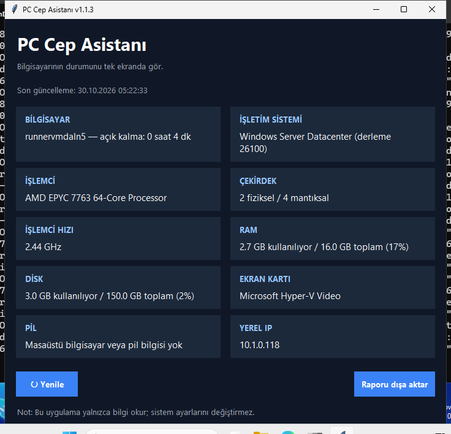

# PC Cep Asistanı

Windows için hafif bir bilgisayar bilgi ve tanılama aracı.

## ⬇️ İndir

**[PCCepAsistani.exe (son sürüm)](https://github.com/Enskygr234/pc-cep-asistani/releases/latest/download/PCCepAsistani.exe)** — Windows 10/11, 64-bit. Kurulum gerektirmez, çift tıklayıp çalıştır.

> İmzasız bir EXE olduğu için Windows SmartScreen "Windows bilgisayarınızı korudu" uyarısı gösterebilir. **Ek bilgi → Yine de çalıştır** ile açabilirsin.

## Ekran görüntüsü



## Özellikler
- İşlemci modeli, çekirdek ve hız bilgisi
- RAM kullanımını görüntüleme
- Sistem diskinin doluluk durumunu görüntüleme
- Ekran kartı adını gösterme (Windows 11 24H2+ dahil; `wmic` gerektirmez)
- Pil yüzdesi ve şarj durumunu gösterme (destekleniyorsa)
- Yerel IP adresi ve bilgisayarın açık kalma süresi
- Bilgileri TXT raporu olarak dışa aktarma
- Tek tıkla yenileme

Uygulama salt okunurdur; dosya silmez, kayıt defterini değiştirmez ve sistem ayarlarına dokunmaz.

## Çalıştırma (Python ile)
```bash
py -m pip install -r requirements.txt
py main.py
```

## EXE oluşturma (yerelde)
```bash
py -m pip install -r requirements.txt pyinstaller
pyinstaller --noconfirm --clean --onefile --windowed --name PCCepAsistani main.py
```
EXE dosyası `dist/PCCepAsistani.exe` içine çıkar.

Pencere açmadan test: `PCCepAsistani.exe --self-test rapor.txt`

## GitHub Actions
`main` dalına kod gönderildiğinde Windows üzerinde:
1. EXE derlenir,
2. `--self-test` ile çalıştırılıp rapor kontrol edilir,
3. uygulamanın gerçek ekran görüntüsü alınır,
4. EXE herkese açık **latest** sürümüne yüklenir (yukarıdaki indirme bağlantısı).

Actions sekmesinden **Run workflow** ile elle de başlatılabilir.
